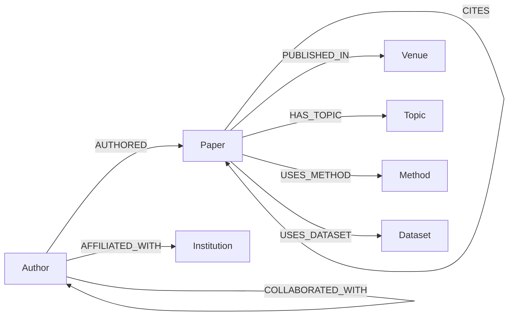

# Knowledge Graph Schema

This is a reference schema for the scholarly knowledge graph. You may extend, simplify or re-model it. If you do, explain why in your report.

## Diagram

## Nodes

| Node | Key properties | Capability |
| --- | --- | --- |
| `Paper` | id, title, year, abstract, doi, citation_count | `core` (+ `text` for abstract) |
| `Author` | id, name, orcid | `core` |
| `Venue` | id, name, type (conference/journal), external rank (e.g. CORE) | `core` |
| `Institution` | id, name, country | `affiliations` |
| `Topic` | id, label, parent topic | `derived` |
| `Method` / `Dataset` / `Task` | id, canonical name, aliases | `derived` |

## Edges

There are three kinds of edges, and you should keep them distinguishable in your graph (e.g. with a `source` property):

- **Imported** edges come straight from the dataset.
- **Derived** edges are computed deterministically from imported edges.
- **Extracted** edges are produced by a model (NER, an LLM, a classifier), so they carry error.

| Edge | Kind | Capability | Interim source | Caveats |
| --- | --- | --- | --- | --- |
| `Author –AUTHORED→ Paper` | imported | `core` | DBLP `<author>` | Keep author order as an edge property; first/last author matters for some analyses |
| `Paper –PUBLISHED_IN→ Venue` | imported | `core` | DBLP key prefix + `booktitle`/`journal` | Normalise venues (e.g. all `conf/acl` years → one venue node; optionally a `VenueEdition` per year) |
| `Paper –CITES→ Paper` | imported | `citations` | Semantic Scholar `references` | Decide how to treat out-of-slice targets (see [dataset §2.3](../dataset/README.md#23-joining-dblp-and-semantic-scholar)) |
| `Author –AFFILIATED_WITH→ Institution` | imported | `affiliations` | DBLP homepage `note type="affiliation"`, OpenAlex | Usually current affiliation only, not time-stamped, and incomplete |
| `Author –COLLABORATED_WITH→ Author` | derived | `core` | Projection of `AUTHORED` | Store weight = number of co-authored papers, plus first/last year. Watch for hyper-authored papers (50+ authors) that create huge cliques; cap or down-weight them |
| `Paper –HAS_TOPIC→ Topic` | extracted | `derived` | Topic model, keyword clustering, LLM tagging, or an existing taxonomy | Needs `text`. Record the confidence and the method used |
| `Paper –USES_METHOD→ Method` (and `USES_DATASET`, `ADDRESSES_TASK`) | extracted | `derived` | NER / LLM extraction over abstracts | Needs `text`. **Entity canonicalisation is the hard part** ("BERT", "BERT-base", "bidirectional encoder representations…"). Evaluate it on a hand-labelled sample |

## Why `derived` entities matter

If your graph contains only `core` + `citations`, many "multi-hop" questions reduce to a database query ("papers by X that cite Y"). Graph retrieval will trivially win those questions, which is not an interesting finding. The research question in this project, *which questions actually benefit from graph structure*, only becomes interesting once questions mix structure with **content**: methods, tasks, claims and findings. That content lives in text, so it either stays in text chunks (vector RAG) or is extracted into the graph (GraphRAG). Comparing those two is the core of the project. See [evaluation.md](evaluation.md).

## Storage options

| Option | When to use |
| --- | --- |
| **NetworkX / igraph** in memory | Fewer than ~10⁶ edges, rapid prototyping, graph algorithms |
| **Neo4j** (Cypher) | Persistent store, LLM-generated Cypher (text-to-Cypher), visual exploration, built-in vector index |
| **Parquet edge tables + DuckDB** | Aggregations and temporal analyses; very fast and simple |
| **PyTorch Geometric `HeteroData`** | When training GNNs (link prediction, node embeddings) |

These can be combined. A common pattern is to keep Parquet as the source of truth and load it into whatever each component needs.

## Questions your report should answer about your graph

- Node and edge counts per type; degree distributions; size of the largest connected component
- Coverage of each capability (e.g. % papers with abstracts, % in-slice citations)
- How you identified and de-duplicated each node type
- For each extracted edge type: how it was produced and its measured precision on a sample
